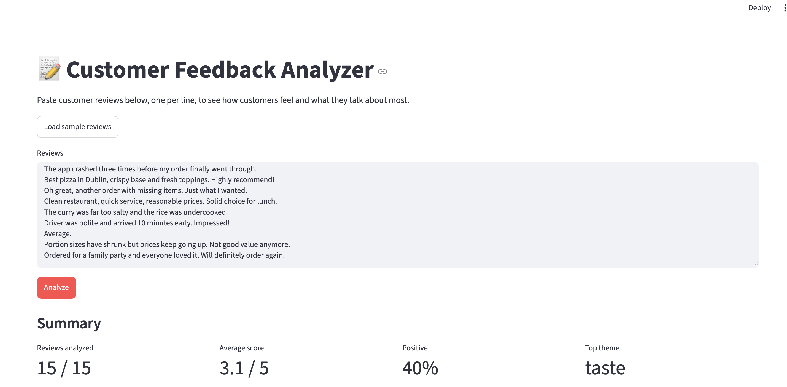
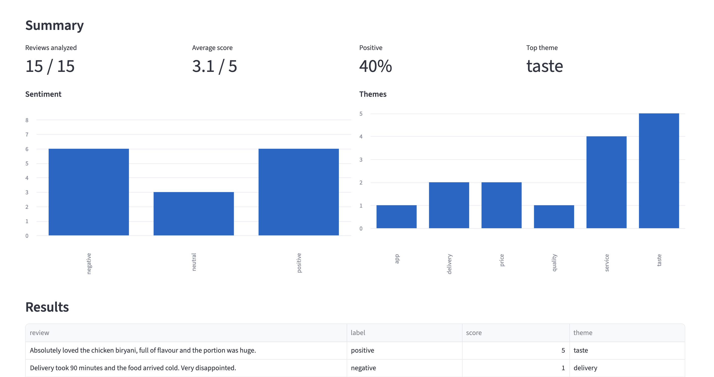
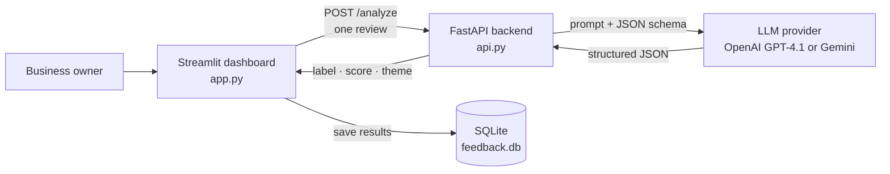

# 📝 Customer Feedback Analyzer

A Generative AI app that turns a pile of customer reviews into instant insight: how customers feel, how they rate the experience, and what they keep talking about. Paste reviews, click **Analyze**, and get a dashboard in seconds.


## The problem

A restaurant owner receives dozens of reviews a week and has no time to read them all. They need answers to three questions fast: *Are customers happy? How happy? What are they complaining about?*

## What it does

- **Sentiment:** classifies each review as positive, negative or neutral.
- **Rating:** scores each review from 1 (very bad) to 5 (very good).
- **Theme:** tags the main topic in one word, such as *delivery*, *price* or *taste*.
- **Dashboard:** shows average score, % positive and the top theme, with sentiment and theme charts.
- **History:** saves analysed reviews to a SQLite database so trends build up over time.

## Screenshots

| Paste reviews and analyze | Results dashboard |
|:---:|:---:|
|  |  |

## Architecture

The AI logic lives in its own **REST API**, and the dashboard is a client of that API. Any other app (a mobile app, a scheduled job, a CRM integration) could call the same backend.



### Design decisions

- **Provider-agnostic.** The backend works with OpenAI (default) or Google Gemini. Switching is one line in `.env`, which keeps the app running when one provider has an outage.
- **Structured output, not free text.** The model is given a Pydantic schema, so every reply is validated JSON: `label` must be positive, negative or neutral, and `score` must be between 1 and 5. Replies are validated again on the server, so out-of-range or malformed values are rejected, never shown.
- **Deterministic results.** Temperature is set to 0, so the same review gets the same analysis.
- **Fault tolerant.** One failed review never stops the batch. Failures are reported with their cause, excluded from the statistics and never saved to the database.
- **Clear errors.** If the backend isn't running, the dashboard says so and explains how to start it. Provider failures (outages, refusals, invalid output) return an HTTP 502 with the reason.
- **Configurable.** The model, backend URL and database path are set in `.env`, not hard-coded.

## API

| Method | Endpoint | Description |
|--------|----------|-------------|
| `GET` | `/health` | Checks that the service is up and reports the provider and model in use |
| `POST` | `/analyze` | Analyses one review |

**Example request**
```bash
curl -X POST http://127.0.0.1:8000/analyze \
  -H "Content-Type: application/json" \
  -d '{"text": "The food was delicious but the delivery took over an hour."}'
```

**Example response**
```json
{"label": "negative", "score": 2, "theme": "delivery"}
```

Interactive documentation is generated automatically at `http://127.0.0.1:8000/docs`.

## Getting started

### Prerequisites
- Python 3.12+
- [uv](https://docs.astral.sh/uv/) package manager
- An [OpenAI API key](https://platform.openai.com/api-keys), or a free Gemini key from [Google AI Studio](https://aistudio.google.com/apikey)

### 1. Clone and install
```bash
git clone https://github.com/Dheer08/Feedback-Analyzer.git
cd Feedback-Analyzer
uv sync
```

### 2. Add your API key
```bash
cp .env.example .env
```
Then open `.env` and set `OPENAI_API_KEY`. To use Gemini instead, set `LLM_PROVIDER=gemini` and `GOOGLE_API_KEY`.

### 3. Start the backend (terminal 1)
```bash
uv run fastapi dev api.py
```

### 4. Start the dashboard (terminal 2)
```bash
uv run streamlit run app.py
```

The dashboard opens at `http://localhost:8501`. Click **Load sample reviews**, then **Analyze**.

### Configuration

| Variable | Default | Purpose |
|----------|---------|---------|
| `LLM_PROVIDER` | `openai` | `openai` or `gemini` |
| `OPENAI_API_KEY` | *(required for OpenAI)* | Your OpenAI API key |
| `GOOGLE_API_KEY` | *(required for Gemini)* | Your Gemini API key |
| `LLM_MODEL` | `gpt-4.1` / `gemini-2.5-flash` | Model used for analysis |
| `BACKEND_URL` | `http://127.0.0.1:8000` | Where the dashboard finds the API |
| `FEEDBACK_DB` | `feedback.db` | SQLite database file |

## Tests

```bash
uv run pytest
```

13 tests cover the API (structured output, schema validation, provider failures and refusals), the dashboard's statistics and error handling, and the database. The LLM is mocked, so the tests run offline and need no API key.

## Project structure

```
Feedback-Analyzer/
├── api.py               # FastAPI backend: calls OpenAI or Gemini with a JSON schema
├── app.py               # Streamlit dashboard: batch analysis, charts, history
├── database.py          # SQLite storage
├── sample_reviews.txt   # 10 example restaurant reviews
├── tests/               # pytest suite (LLM mocked)
├── images/              # Screenshots used in this README
├── .env.example         # Template for your API key and settings
├── pyproject.toml       # Dependencies (managed with uv)
└── uv.lock
```

## Future improvements

- Analyse reviews concurrently, or in one batched request, for large volumes.
- Upload reviews from a CSV file and export results.
- Track sentiment over time with dates and trend charts.
- Deploy the backend to Cloud Run and the dashboard to Streamlit Community Cloud.

## Author

**Rakshith Dheer Reddy Kunduru**, Data & AI engineer, Dublin

[GitHub](https://github.com/Dheer08) · [LinkedIn](https://www.linkedin.com/in/rakshith-dheer-reddy-446718189) · [Portfolio](https://dheer08.github.io/RakshithDheer/)
